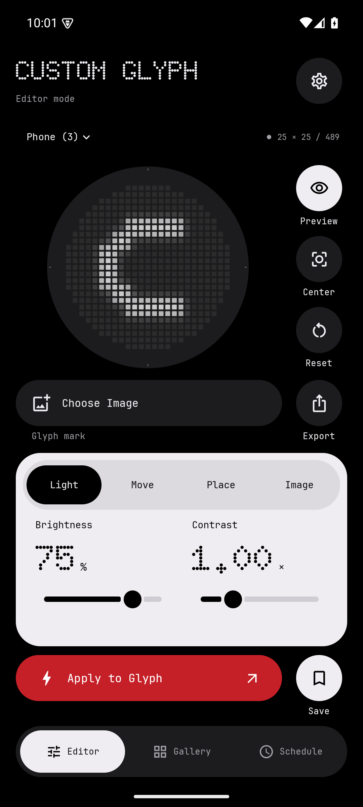
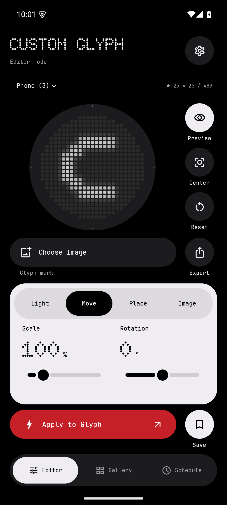
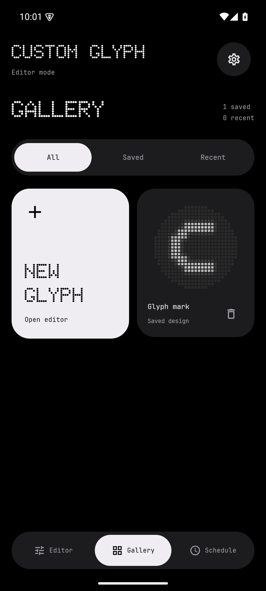

<p align="center"></p>
<h1 align="center">Custom Glyph</h1>
<p align="center">An image editor for the rear Glyph Matrix on Nothing Phone (3) and Phone (4a) Pro.</p>
<p align="center"><a href="#install">Install</a> · <a href="#build">Build</a> · <a href="docs/VERIFICATION.md">Verification</a> · <a href="https://x.com/PossiblyTejas">@PossiblyTejas</a></p>

## Version 1.0

Custom Glyph is a native Kotlin / Jetpack Compose app. Import artwork, position it on the physical LED grid, and use Nothing's official SDK to submit the result.

- PNG, JPEG, WebP, self-contained SVG and animated GIF import.
- A pinned matrix preview with Light, Move, Place and Image adjustment tabs.
- Pinch, drag, rotation, quarter-LED positioning, scale, brightness, contrast, silhouette, inversion and dithering.
- A Gallery with 30 saved designs and the last 12 applied or replaced edits.
- Editable weekday schedules, overnight windows and a stop timer.
- PNG / SVG pixel-map export, a 1000 px display artwork export, and Android sharing.
- Doto headings, JetBrains Mono controls, flat monochrome widgets, an adaptive icon and guided display setup.

<p align="center">
  
  
  
</p>

## Device support

| Device | Grid | Physical LEDs | App display | Glyph Toy / Always-On |
| --- | --- | --- | --- | --- |
| Nothing Phone (3) | 25 × 25 | 489 | While unlocked, using `setAppMatrixFrame` | Supported through the system-selected toy |
| Nothing Phone (4a) Pro | 13 × 13 | 137 | Not enabled by this integration | AOD toys only, per the official SDK |
| Other Android phones (Android 13+) | Both preview profiles | — | No hardware access | Editor, Gallery, schedules and export only |

The masks and LED spacing come from Nothing's official SVG specifications. The same processed pixel maps feed the preview, export and SDK adapter. Display appearance on a screen cannot calibrate the physical LEDs' brightness.

**Physical-device verification is still required for both models.** The editor and platform flows have been tested on an Android 15 emulator; a passing SDK request does not prove that an LED illuminated. See [the verification record](docs/VERIFICATION.md).

## Install

A signed local APK accompanies this project handoff. A public APK release is pending physical-device validation and review of Nothing’s SDK distribution terms. See [Build](#build) to compile your own copy.

1. Transfer `CustomGlyph-1.0.apk` to your phone and open it. Allow installation from that file manager/browser when Android asks.
2. If the earlier **Glyph Studio** prototype is installed, stop or uninstall it first. Its application ID differs and both apps can otherwise request the display.
3. Open Custom Glyph and follow **Set up display**. The checklist requests Glyph access when exposed as a runtime permission, notifications, and optional background battery access on Phone (3).
4. In Nothing OS, add/select **Custom Glyph** under Glyph Toys. Then select **Custom Glyph as the Always-On toy**, replacing the clock, under **Settings → Glyph Interface → Flip to Glyph → Always-on Glyph Toy**. Some firmware uses the name **Always-on Glyph** instead.
5. Import an image and tap **Apply to Glyph**. Place the phone face down to check Always-On behavior.

The app uses the supported Glyph Toys manager shortcut. If that activity is unavailable, it opens system settings and shows the manual path. Nothing OS does not expose the chosen Always-On toy to third-party apps, so the checklist labels that item as user-confirmed. Other permission states are rechecked when you return.

### If the clock keeps returning

Selecting a toy with the rear Glyph Button does not necessarily change the **Always-On** selection. Choose Custom Glyph in the Always-On settings, stop other apps that control the matrix, and apply again. Use **Settings → Review display setup** to revisit these steps.

On Phone (3), the app releases its direct-display route when the phone locks. The system-selected toy owns locked face-down output. A single SDK connection coordinates the app and Toy routes; the app does not repeatedly overwrite the clock or bypass system priority. **Show while unlocked** can be disabled in settings for Toy-only operation.

Nothing OS can still interrupt output for other toys, notifications, battery policy or firmware behavior. Continuous illumination is **not guaranteed**. The SDK provides no physical-display acknowledgment. The reported clock/image switching across lock/unlock has a routing fix in this version but still needs a repeat test on the affected Phone (3).

## Using the editor

Choose the detected phone profile, or select a different profile to prepare an export. Applying a mismatched profile on a supported phone is rejected. Drag to move; pinch and twist to scale and rotate. **Light** contains brightness and contrast. **Move** contains scale and rotation. **Place** contains quarter-LED X/Y controls. **Image** contains Tonal/Silhouette mode, inversion and dithering. **Center** resets translation; **Reset** restores adjustments.

In landscape and at larger text sizes, **Actions** contains Choose Image, Preview, Center, Reset and Export / Share.

Use **Silhouette** for a dark logo with transparency. **Tonal** converts luminance; contrast and inversion act before alpha compositing. Dithering converts tones to an ordered on/off pattern at the selected brightness. Transparent pixels stay dark.

GIFs play in the editor and can be sent frame by frame while the app or selected toy is awake. Nothing OS can suspend playback in Always-On/deep sleep. Disable **Animate GIFs** to show the first frame. Pause the editor's playback and scrub to export a particular frame; PNG/SVG exports are static. The **Export** menu also contains **Share image**.

### Import limits

| Input | Limit |
| --- | --- |
| File size | 32 MiB |
| Still raster | At most 30,000 px per dimension; decoded to at most 1024 px |
| SVG | 2 MiB; paths/shapes only; no scripts, entities, external resources or embedded images |
| GIF | 4096 px per dimension, 240 frames, 30 seconds after frame-rate limiting; decoded to at most 128 px |
| Playback | At most 12 fps; very fast GIFs are slowed |

Animated WebP/APNG are imported as a still image. SVG text depends on available fonts; convert text to outlines for portable results.

## Gallery and scheduling

**Save** creates a named, permanent Gallery entry. Applying a design or replacing an imported edit adds it to **Recent**. Recent retains 12 entries. Scheduling a recent edit promotes it to a saved design so history cleanup cannot remove a scheduled image.

Tap a schedule's pencil to change its design, times or weekdays, then choose **Update schedule**.

Schedules use the phone's local wall clock. Start is inclusive; end is exclusive. An overnight window belongs to the weekday on which it starts. Equal start and end times mean the whole selected calendar day. Later rules win when windows overlap. Outside all windows, the last manually applied design is used.

Schedules only select content; tap Apply to enable display. The stop timer disables all output until Apply is used again. Applying also cancels an existing stop timer. Settings and deadlines survive process restarts and reboot.

No exact alarms or wake locks are used. While the service is awake, rules and timers are checked at least once per second. In deep sleep or system-managed AOD, a change can wait for the next OS wake/bind/AOD callback. The official AOD event is delivered once per minute when the toy is selected. Reboot restoration is subject to Android's foreground-service rules and happens after first unlock.

## Build

Requirements: JDK 17, Android SDK Platform 36, Build Tools 35.0.0, and network access for the first dependency download. The checked-in Gradle wrapper uses Gradle 8.11.1; its distribution checksum is pinned.

```sh
git clone https://github.com/thetejasagrawal/CustomGlyph-.git
cd CustomGlyph-
# Read licenses/NOTHING-SDK.md before accepting its terms.
./scripts/fetch-sdk.sh --accept-license
# Set ANDROID_HOME or create local.properties with sdk.dir=/your/android/sdk
./gradlew :app:assembleDebug
```

Open this folder in Android Studio to edit or run the app. No private account, backend configuration or root access is needed.

### Signed APK

```sh
# JAVA_HOME must point to JDK 17. Run once; preserve the generated identity.
./scripts/create-release-key.sh
./gradlew :app:assembleRelease
```

The output is `app/build/outputs/apk/release/app-release.apk`. Without `signing.properties`, release builds are unsigned. The repository and source archive exclude all signing material. Back up the key and `signing.properties` privately; future updates must use the same certificate.

Nothing's example uses `NothingKey=test`; that is the default manifest placeholder here. If Nothing issues a production key, build with `-PnothingKey=YOUR_KEY`. Registration depends on the firmware and SDK permission; this repository does not claim production key approval.

### Checks

```sh
./gradlew spotlessApply
./gradlew spotlessCheck :app:testDebugUnitTest :app:lintRelease :app:assembleRelease
./gradlew :app:connectedDebugAndroidTest
python3 scripts/package-source.py
```

The instrumented SDK conversion test intentionally skips unsupported devices. Do not spoof device identifiers to make it pass. CI checks formatting, unit tests, lint and release compilation; hardware tests remain a separate release gate.

## Code structure

```text
app/src/main/java/dev/customglyph/
  data/       Atomic files, draft/library serialization, schedule storage
  glyph/      SDK owner, Toy/foreground services, routing and sensors
  imaging/    Bounded decoders, alpha-aware rendering, PNG/SVG export
  model/      Device geometry, frame sequences and scheduling rules
  ui/         Compose screens, controls, theme and editor state
```

Image processing and file I/O run outside the main thread. Preview playback stops when the UI is not started. Rendering is independent of SDK code, so geometry, compositing, transforms and policy can be tested without a Nothing phone.

## Privacy, permissions and licensing

The app has no internet permission, analytics or broad storage access. It uses the document picker, private files and temporary FileProvider grants for sharing. App backups are disabled. Uninstalling removes private images, Gallery entries and settings; exported files remain wherever you saved them.

Original application code and artwork are [MIT licensed](LICENSE). Dependencies have their own [licenses and notices](THIRD_PARTY_NOTICES.md). **Nothing's SDK is proprietary and is not committed to this repository.** Its EULA restricts redistribution and commercial use; public binary distribution must be cleared under those terms. The setup script retrieves a checksum-verified, unmodified SDK from Nothing's official repository.

Made by [Tejas Agrawal](https://x.com/PossiblyTejas). Independent project; not affiliated with Nothing.
